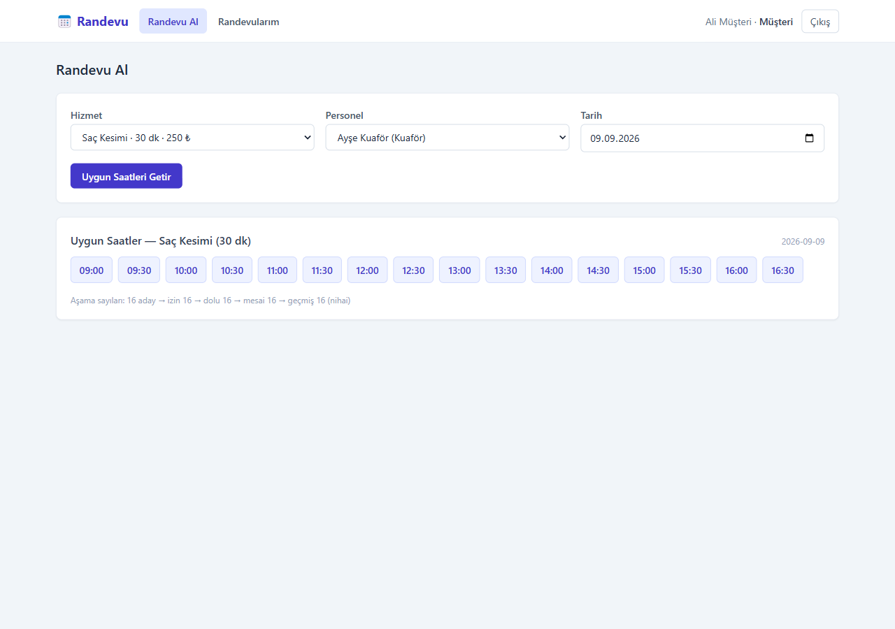
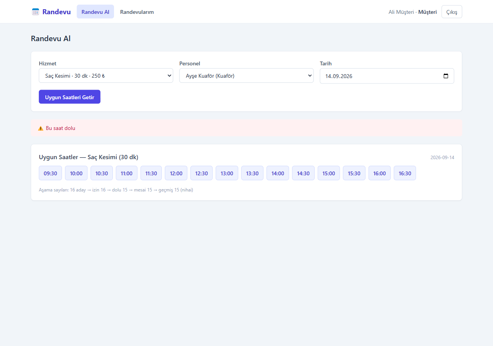

# Randevu – Rezervasyon Yönetim Sistemi

Kuaför, klinik gibi işletmeler için randevu sistemi. Üç rol var:

- **Yönetici:** hizmetleri ve personeli tanımlıyor, bütün randevuları takvimde görüyor.
- **Personel:** çalışma saatlerini ve izin günlerini giriyor, kendi randevularını görüyor.
- **Müşteri:** hizmet, personel ve gün seçip o gün için boş saatleri görüyor, randevu alıyor, iptal ediyor ya da erteliyor.

Yaz stajımın ikinci projesi. İlk projem [TaskFlow](https://github.com/UBKc/taskflow)'da ham SQL kullanmıştım, bunda iki yaklaşımı karşılaştırmak için ORM (Prisma) kullandım.



## Kullanılan teknolojiler

| Katman | Teknoloji |
|---|---|
| Backend | Node.js, Express, TypeScript |
| Veritabanı | PostgreSQL 16, Prisma |
| Doğrulama | Zod |
| Giriş | JWT, bcryptjs |
| Frontend | React (Vite), TypeScript, Tailwind CSS |
| Test | node:test, Postman / Newman |

## Projenin zor kısımları

### 1. Boş saatlerin hesaplanması

Bir personelin o gün hangi saatlerde müsait olduğu şu sırayla hesaplanıyor (`slots.core.ts`):

1. Personelin o günkü çalışma saatlerinden, hizmet süresine göre aday saatler çıkarılıyor.
2. Bitişi mesai bitimini aşan saatler eleniyor.
3. Dolu randevularla çakışan saatler eleniyor.
4. İzinli saatler eleniyor.
5. Gün bugünse geçmiş saatler eleniyor.

Arka arkaya randevular (09:00-09:30 ve 09:30-10:00) çakışma sayılmıyor. Hesaplama veritabanından ayrı, saf bir fonksiyon olduğu için birim testi yazabildim: 11 test, hepsi geçiyor (`docs/test_ciktilari/04-slot-testleri.txt`).

### 2. Çakışan randevuların engellenmesi

Aynı personele kesişen iki randevu yazılmasını iki katmanda engelledim:

- **Uygulama:** randevu kaydedilmeden önce çakışma kontrol ediliyor.
- **Veritabanı:** PostgreSQL'in `EXCLUDE USING gist` kısıtı. `UNIQUE(personel, başlangıç)` yetmiyor, çünkü 09:00-10:00 ile 09:30-10:30 farklı saatlerde başlayıp yine kesişiyor.

```sql
ALTER TABLE "appointments"
  ADD CONSTRAINT "appointments_no_overlap"
  EXCLUDE USING gist ("staffId" WITH =, tstzrange("startAt","endAt") WITH &&)
  WHERE ("status" <> 'CANCELLED');
```

Prisma bu kısıtı kendi şema dilinde yazamıyor. Bu yüzden migration'ı `--create-only` ile oluşturup SQL'i elle ekledim. İptal edilen randevular kısıtın dışında, yani iptal edilen saat tekrar alınabiliyor.

### 3. Aynı anda gelen iki istek

İki müşteri aynı saati aynı anda almaya çalıştığında ikisi de uygulama kontrolünden geçebiliyor. Bunu `scripts/concurrency-test.ts` ile gerçekten test ettim: iki istek aynı anda gönderiliyor, ikisi de "slot boş" görüyor, ama veritabanı kısıtı ikinciyi reddediyor. Sonuç: bir istek 201, diğeri 409. Ham PostgreSQL hatası kullanıcıya gitmiyor, anlaşılır bir mesaja çevriliyor (`docs/test_ciktilari/05-eszamanlilik-testi.txt`).



## Kurulum

PostgreSQL 16 gerekiyor. Docker varsa `docker compose up -d` ile kaldırılabilir.

Backend:

```
cd backend
cp .env.example .env      # DATABASE_URL ve JWT_SECRET'i doldur
npm install
npx prisma migrate dev
npm run seed
npm run dev
```

API `http://localhost:4001`, Swagger `http://localhost:4001/api/docs` adresinde.

Frontend:

```
cd frontend
npm install
npm run dev
```

## Testler

```
cd backend
npm test                    # slot hesaplama birim testleri
npm run test:concurrency    # eşzamanlı randevu testi
```

Postman koleksiyonu `postman/` klasöründe. Newman ile 12 istek ve 22 kontrol çalıştı, hepsi geçti (`docs/test_ciktilari/06-newman-cikti.txt`).

## Demo kullanıcılar

`npm run seed` ile gelen kullanıcıların hepsinin şifresi `Parola123!`.

| E-posta | Rol |
|---|---|
| `admin@randevu.local` | yönetici |
| `ayse@randevu.local` | personel |
| `ali@ornek.com` | müşteri |

## Eksikler

- Randevu hatırlatma (e-posta / SMS) yok.
- Ödeme alınmıyor.
- Frontend için otomatik test yazılmadı.
